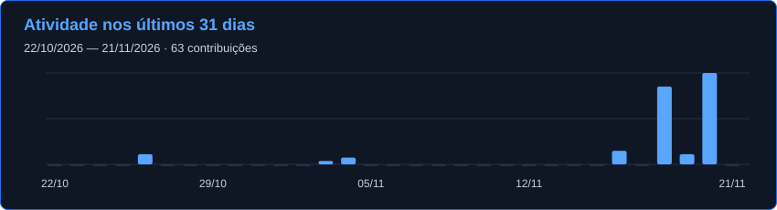
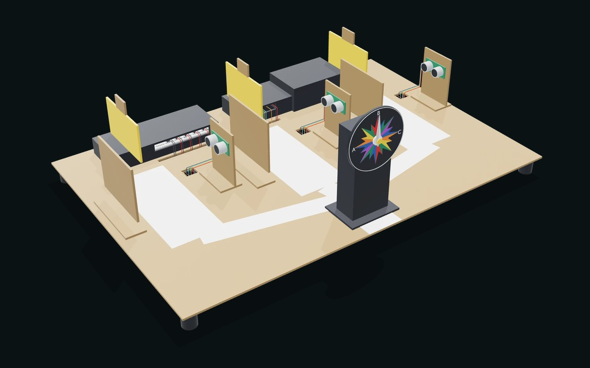
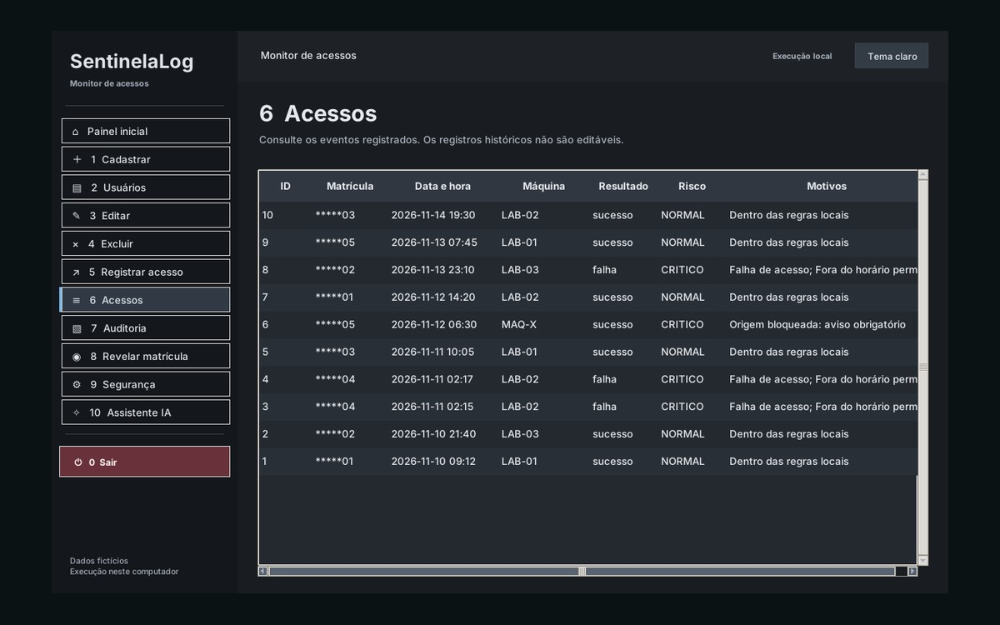
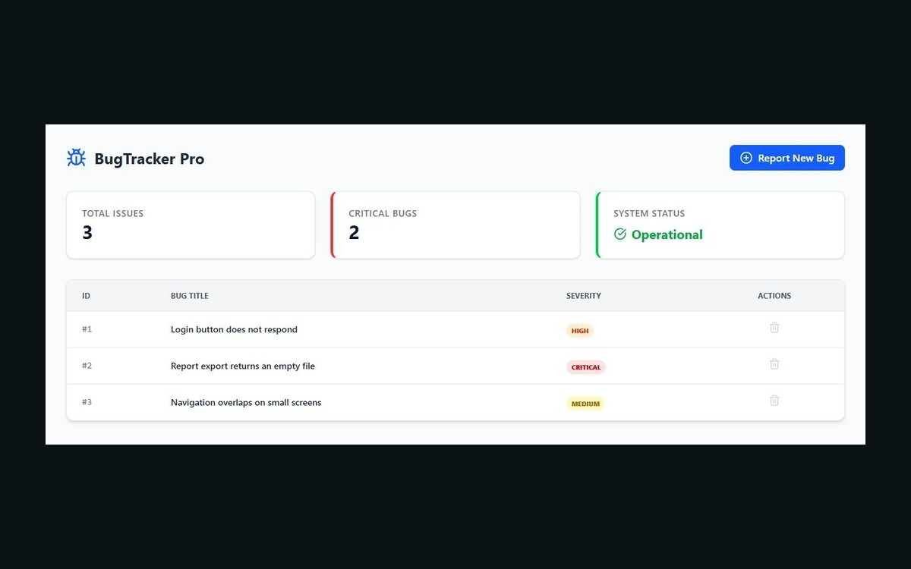

  
   
  

  
  
  

<a href="README.md">Português</a> · <b>English</b>

## About me

Law graduate and **Computer Science student at CESAR School**. Since 2023 I have been building projects that bring together **hardware, software and AI**, and I am now looking for my first internship in the field.

- Computer Science at CESAR School, 1st semester
- Leading **Bússola de Fluxo Urbano** (Urban Flow Compass), my Projects I course project
- Fascinated by games, worldbuilding and everything that goes on inside them
- Contact: [guilhermealcantara90@hotmail.com](mailto:guilhermealcantara90@hotmail.com) or [LinkedIn](https://www.linkedin.com/in/guilhermealcantarabatistaalencardeoliveira)

## Technologies

## Activity

## Projects

|  |  |  |
| :-- | :-- | :-- |
| **Bússola de Fluxo Urbano** Scale model with sensors and Arduino that points to the busiest route. I lead the team of eight. | **SentinelaLog** Python access monitor that rates the risk of each access and explains the reason for every alert. | **Bug Tracker Pro** React dashboard with a FastAPI backend to log bugs and track their severity. |
| [View on site](https://guilhermeabaoliveira.github.io/projeto-1.html) · [3D model](https://guilhermeabaoliveira.github.io/bussola-fluxo-urbano/atlas-3d/) · [Code](https://github.com/guilhermeabaoliveira/bussola-fluxo-urbano) | [View on site](https://guilhermeabaoliveira.github.io/sentinelalog.html) · [Download for Windows](https://github.com/guilhermeabaoliveira/sentinela-log/releases/tag/v2026.11.18-final.2) · [Code](https://github.com/guilhermeabaoliveira/sentinela-log) | [View on site](https://guilhermeabaoliveira.github.io/bug-tracker.html) · [Code](https://github.com/guilhermeabaoliveira/bug-tracker-pro) |

<picture>
  <source media="(prefers-color-scheme: dark)" srcset="https://raw.githubusercontent.com/guilhermeabaoliveira/guilhermeabaoliveira/output/github-contribution-grid-snake-blue-dark.svg" />
  <source media="(prefers-color-scheme: light)" srcset="https://raw.githubusercontent.com/guilhermeabaoliveira/guilhermeabaoliveira/output/github-contribution-grid-snake-blue.svg" />
  
</picture>

Repository languages

Education

- **Computer Science, CESAR School:** bachelor’s degree in progress, 1st semester.
- **Law, UNICAP:** bachelor’s degree completed.
- **Postgraduate specializations (FAMEESP):** Software Engineering, Artificial Intelligence and Game Design.

