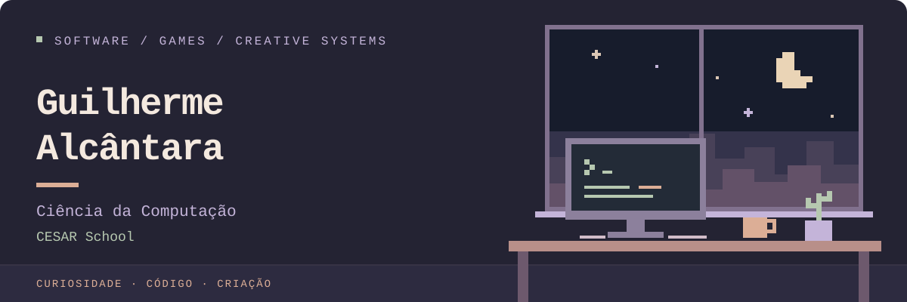

  

  
  
  

## Olá, sou Guilherme

Estudante do **1º período de Ciência da Computação na CESAR School**, com ingresso em **3 de agosto**. Me interesso por engenharia de software, desenvolvimento de jogos e inteligência artificial aplicada.

Desenvolvo projetos práticos enquanto aprofundo fundamentos de programação, organização de sistemas e resolução de problemas. Busco oportunidades de **estágio ou desenvolvimento júnior**, com espaço para aprender e contribuir.

**Interesses:** aplicações e APIs · sistemas de jogos · experiências interativas

## Projetos selecionados

| Projeto | Aplicação | Tecnologias |
| :--- | :--- | :--- |
| **[Bug Tracker Pro](https://github.com/guilhermeabaoliveira/bug-tracker-pro)** | Aplicação full stack para registrar, listar e excluir bugs. | React · FastAPI · SQLite |
| **[API Automated Tests](https://github.com/guilhermeabaoliveira/api-automated-tests)** | Testes de requisições GET e POST sobre o JSONPlaceholder. | Python · Pytest · Requests |
| **[Minha Primeira API](https://github.com/guilhermeabaoliveira/minha-primeira-api)** | API de tarefas com persistência local. | Python · FastAPI · TinyDB |

## Tecnologias e ferramentas

Linguagens, ferramentas e áreas presentes nos meus estudos e projetos.

**Linguagens**

**Jogos e experiências interativas**

**Dados e desenvolvimento**

## Formação

**Graduação em andamento** 
Ciência da Computação · **CESAR School** · 1º período

**Formação em pós-graduação** 
Engenharia de Software · Game Design · Inteligência Artificial

## English

<strong>About me · English</strong>

### Guilherme Alcântara

First-semester **Computer Science student at CESAR School**, enrolled on **August 3**. My interests include software engineering, game development, and applied artificial intelligence.

I build practical projects while strengthening my programming, system design, and problem-solving foundations. I am seeking **internship or junior developer opportunities** to learn and contribute.

My postgraduate education spans **Software Engineering**, **Game Design**, and **Artificial Intelligence**.

Selected projects include a full stack bug tracker, automated API tests, and a task API. See the repositories above for features and setup instructions.

## Atividade no GitHub

  
  

<picture>
  <source media="(prefers-color-scheme: dark)" srcset="https://raw.githubusercontent.com/guilhermeabaoliveira/guilhermeabaoliveira/output/github-contribution-grid-snake-dark.svg" />
  <source media="(prefers-color-scheme: light)" srcset="https://raw.githubusercontent.com/guilhermeabaoliveira/guilhermeabaoliveira/output/github-contribution-grid-snake.svg" />
  
</picture>

  

