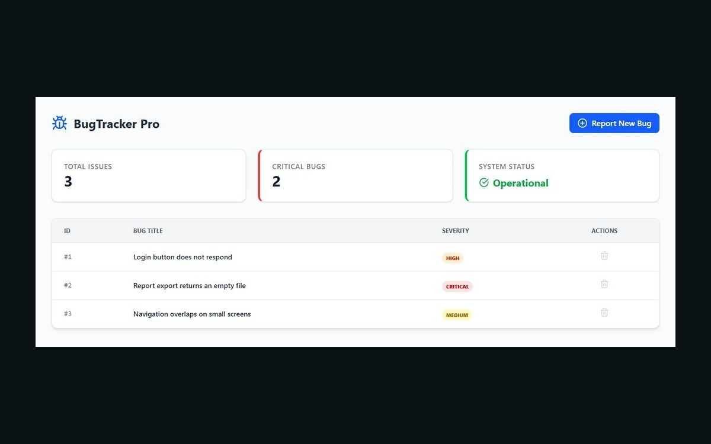

  

  

  
  
  

 

<table>
  <tr>
    <td width="33%" valign="top">
      
      <h3>Bússola de Fluxo Urbano</h3>
      
Maquete com sensores e Arduino que aponta a rota mais movimentada. Lidero a equipe de oito pessoas.

      
<a href="https://guilhermeabaoliveira.github.io/bussola-fluxo-urbano/atlas-3d/">Maquete 3D</a> · <a href="https://github.com/guilhermeabaoliveira/bussola-fluxo-urbano">Código</a>

    </td>
    <td width="33%" valign="top">
      
      <h3>SentinelaLog</h3>
      
Monitor de acessos em Python que classifica o risco e explica o motivo de cada alerta.

      
<a href="https://github.com/guilhermeabaoliveira/sentinela-log/releases/tag/v2026.11.18-final.2">Baixar para Windows</a> · <a href="https://github.com/guilhermeabaoliveira/sentinela-log">Código</a>

    </td>
    <td width="33%" valign="top">
      
      <h3>Bug Tracker Pro</h3>
      
Painel em React com API em FastAPI para registrar bugs e acompanhar a gravidade.

      
<a href="https://github.com/guilhermeabaoliveira/bug-tracker-pro">Código</a>

    </td>
  </tr>
</table>

  <a href="https://guilhermeabaoliveira.github.io/"><b>Ver todos os projetos no portfólio</b></a>

 

  

 

  

<picture>
  <source media="(prefers-color-scheme: dark)" srcset="https://raw.githubusercontent.com/guilhermeabaoliveira/guilhermeabaoliveira/output/github-contribution-grid-snake-blue-dark.svg" />
  <source media="(prefers-color-scheme: light)" srcset="https://raw.githubusercontent.com/guilhermeabaoliveira/guilhermeabaoliveira/output/github-contribution-grid-snake-blue.svg" />
  
</picture>

<b>Outros repositórios</b>

 

- [**api-automated-tests**](https://github.com/guilhermeabaoliveira/api-automated-tests): testes de API com Python, Pytest e Requests.
- [**minha-primeira-api**](https://github.com/guilhermeabaoliveira/minha-primeira-api): API de tarefas com FastAPI e persistência local.

<b>Formação</b>

 

- **Ciência da Computação**, CESAR School, desde agosto de 2026.
- **Pós-graduações**, FAMEESP: Engenharia de Software (MBA), Inteligência Artificial na Prática e Design de Jogos Virtuais.
- **Direito**, Universidade Católica de Pernambuco (UNICAP).

<b>Linguagens dos repositórios</b>

 

