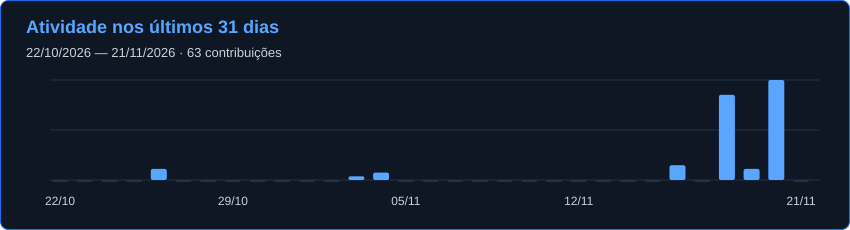
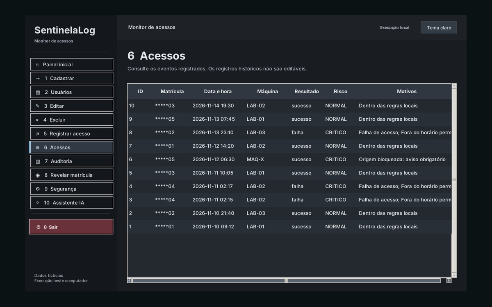

  
   
  

  
  
  

Bacharel em Direito e estudante de Ciência da Computação na CESAR School. 
Desde 2023 construo projetos que juntam hardware, software e IA, e agora busco meu primeiro estágio na área.

  

  

  

<table>
  <tr>
    <td width="33%" valign="top">
      
      <h3>Bússola de Fluxo Urbano</h3>
      
Maquete com sensores e Arduino que aponta a rota mais movimentada. Lidero a equipe de oito pessoas.

      
<a href="https://guilhermeabaoliveira.github.io/bussola-fluxo-urbano/atlas-3d/">Maquete 3D</a> · <a href="https://github.com/guilhermeabaoliveira/bussola-fluxo-urbano">Código</a>

    </td>
    <td width="33%" valign="top">
      
      <h3>SentinelaLog</h3>
      
Monitor de acessos em Python que classifica o risco e explica o motivo de cada alerta.

      
<a href="https://github.com/guilhermeabaoliveira/sentinela-log/releases/tag/v2026.11.18-final.2">Baixar para Windows</a> · <a href="https://github.com/guilhermeabaoliveira/sentinela-log">Código</a>

    </td>
    <td width="33%" valign="top">
      
      <h3>Bug Tracker Pro</h3>
      
Painel em React com API em FastAPI para registrar bugs e acompanhar a gravidade.

      
<a href="https://github.com/guilhermeabaoliveira/bug-tracker-pro">Código</a>

    </td>
  </tr>
</table>

<picture>
  <source media="(prefers-color-scheme: dark)" srcset="https://raw.githubusercontent.com/guilhermeabaoliveira/guilhermeabaoliveira/output/github-contribution-grid-snake-blue-dark.svg" />
  <source media="(prefers-color-scheme: light)" srcset="https://raw.githubusercontent.com/guilhermeabaoliveira/guilhermeabaoliveira/output/github-contribution-grid-snake-blue.svg" />
  
</picture>

Linguagens dos repositórios

Formação acadêmica

- **Ciência da Computação — CESAR School:** graduação em andamento, 1º período.
- **Formação em pós-graduação:** Engenharia de Software, Game Design e Inteligência Artificial.

