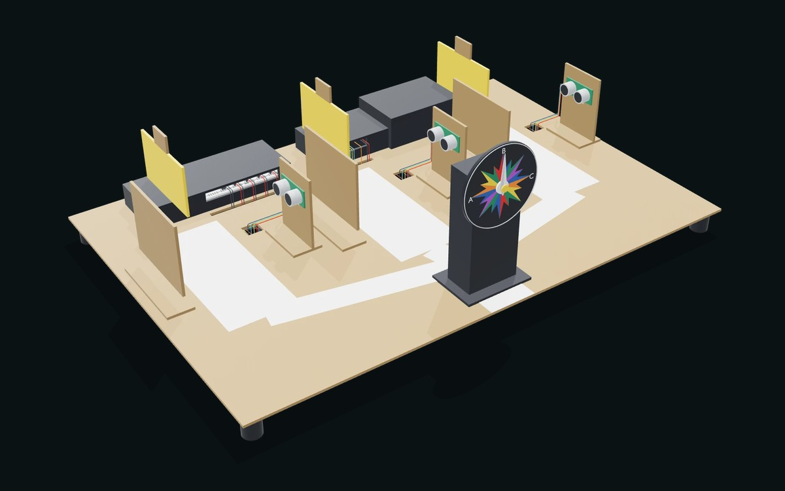

  
   
  

  
  
  

<b>Português</b> · <a href="README.en.md">English</a>

## Sobre mim

Bacharel em Direito e estudante de **Ciência da Computação na CESAR School**. Desde 2023 construo projetos que juntam **hardware, software e IA**, e agora busco meu primeiro estágio na área.

- Ciência da Computação na CESAR School, 1º período
- Liderando a **Bússola de Fluxo Urbano**, projeto de Projetos I
- Fascinado por jogos, worldbuilding e por tudo que existe por dentro deles
- Contato: [guilhermealcantara90@hotmail.com](mailto:guilhermealcantara90@hotmail.com) ou [LinkedIn](https://www.linkedin.com/in/guilhermealcantarabatistaalencardeoliveira)

## Tecnologias

## Atividade

## Projetos

|  |  |  |
| :-- | :-- | :-- |
| **Bússola de Fluxo Urbano** Maquete com sensores e Arduino que aponta a rota mais movimentada. Lidero a equipe de oito pessoas. | **SentinelaLog** Monitor de acessos em Python que classifica o risco e explica o motivo de cada alerta. | **Bug Tracker Pro** Painel em React com API em FastAPI para registrar bugs e acompanhar a gravidade. |
| [Ver no site](https://guilhermeabaoliveira.github.io/projeto-1.html) · [Maquete 3D](https://guilhermeabaoliveira.github.io/bussola-fluxo-urbano/atlas-3d/) · [Código](https://github.com/guilhermeabaoliveira/bussola-fluxo-urbano) | [Ver no site](https://guilhermeabaoliveira.github.io/sentinelalog.html) · [Baixar para Windows](https://github.com/guilhermeabaoliveira/sentinela-log/releases/tag/v2026.11.18-final.2) · [Código](https://github.com/guilhermeabaoliveira/sentinela-log) | [Ver no site](https://guilhermeabaoliveira.github.io/bug-tracker.html) · [Código](https://github.com/guilhermeabaoliveira/bug-tracker-pro) |

<picture>
  <source media="(prefers-color-scheme: dark)" srcset="https://raw.githubusercontent.com/guilhermeabaoliveira/guilhermeabaoliveira/output/github-contribution-grid-snake-blue-dark.svg" />
  <source media="(prefers-color-scheme: light)" srcset="https://raw.githubusercontent.com/guilhermeabaoliveira/guilhermeabaoliveira/output/github-contribution-grid-snake-blue.svg" />
  
</picture>

Linguagens dos repositórios

Formação acadêmica

- **Ciência da Computação, CESAR School:** graduação em andamento, 1º período.
- **Direito, UNICAP:** bacharelado concluído.
- **Pós-graduações (FAMEESP):** Engenharia de Software, Inteligência Artificial e Design de Jogos Virtuais.

